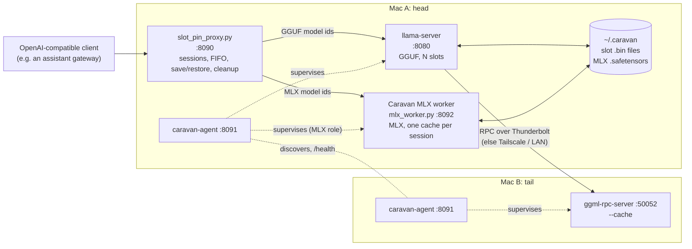
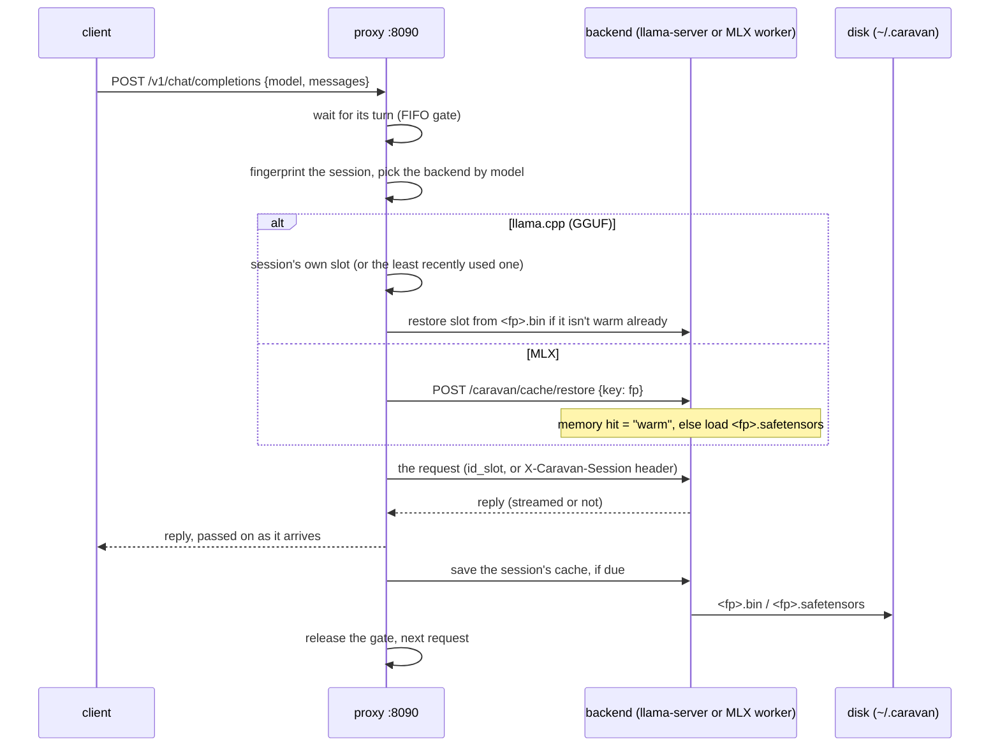

# Architecture

How Caravan v2.1 is put together. For settings see
[CONFIGURATION.md](CONFIGURATION.md). For the MLX worker in depth see
[MLX.md](MLX.md).

## The pieces

| component | code | what it does |
|---|---|---|
| Proxy | `proxy/slot_pin_proxy.py`, `proxy/backends.py` | The one front door. Recognizes each conversation (session), routes by model to llama.cpp or MLX, runs requests one at a time, saves and restores each session's cache, cancels requests whose client is gone. |
| Saved-chat cleanup | `proxy/slot_cleanup.py` | Inside the proxy (and as a CLI): removes or archives saves older than N days, then holds all saves to a per-Mac cap. |
| Agent | `agent/caravan_agent.py` and friends | Runs the same way on every Mac. It finds peers, picks a role (head, tail or MLX), builds the server command, and supervises it. It also serves `/health` on port 8091. |
| llama.cpp | `~/dev/llama.cpp` (fork `RookiOS72/llama.cpp`, branch `caravan-patches`) | `llama-server` on the head and `ggml-rpc-server` on the tail. |
| MLX worker | `agent/mlx_worker.py`, launched via `agent/mlx_backend.py` | Caravan's own OpenAI-compatible MLX server with per-session caches. See [MLX.md](MLX.md). |
| launchd | `launchd/` | Plists for the agent, the proxy, and a manual per-role setup. The llama-server and MLX plists can be rendered from the agent's own command builders (`render_llama_plist.py`, `render_mlx_plist.py`). |
| C++ binary | `cpp/` | Experimental: head or tail in one process, linking llama.cpp. Proven end to end once; not production-ready. |

## A request, start to finish

1. **One at a time.** Every completion request (`/v1/chat/completions`,
   `/v1/completions`, `/completion`) takes a ticket at a strict FIFO gate.
   On a single Mac, and even more over RPC, two jobs at once split the
   speed and evict each other's cache. Other requests (`/v1/models`,
   `/health`, `/slots`) skip the gate and go to llama-server.
2. **Session fingerprint.** For chat requests, it's a hash of the first
   real non-system message. That message never changes for the life of a
   conversation, and no client cooperation is needed. A synthetic
   "(session bootstrap)" marker that some clients insert is skipped. For
   raw-prompt requests, it's a hash of the first 2048 characters (a
   growing prompt keeps its prefix). Shorter or batched prompts are
   one-shots: they run, but they're never pinned or saved. Caveat: two
   different chats that start with the same first message share a
   session.
3. **Routing.** A `model` that starts with `mlx-community/`, or is listed
   under `mlx.models`, goes to the MLX worker. The proxy rewrites it to
   the local model directory and drops llama-only fields. Everything else
   goes to llama-server.
4. **Client gone = cancel.** While waiting and while streaming, the proxy
   checks whether the client is still connected. If not, it closes its own
   upstream connection. llama-server and the MLX worker both stop the job,
   and the gate is freed.
5. **Save after the reply**, still holding the gate, so the next request
   waits for the save, never overlapping it. If the upstream is down, the
   client gets a clear 502 that names the backend.

## Sessions on llama.cpp: slots

- llama-server runs with `--parallel N --no-kv-unified` (N = `n_slots`,
  default 4) and `-c N × ctx_per_slot` (default 64K per slot), so each
  slot owns its own context. With a unified pool, restoring one big
  session could leave no room for the others.
- A session keeps its slot. A new session takes an empty slot, or else the
  least recently used one. Before a slot is handed over, the old occupant
  is saved if it has unsaved turns. Assignments persist in
  `~/.caravan/proxy/session_slots.json`.
- **Save** (`POST /slots/<id>?action=save`, `<fp>.bin` in
  `~/.caravan/llama-server/slots/`, about 1 GB for a long session). It runs
  after each reply, every N turns, or from an idle saver
  (`slot_idle_save_seconds`). It's skipped when the slot's token count
  hasn't changed.
- **Restore** (`?action=restore`) on a session's first request after a
  restart. It's skipped when llama-server still holds that session warm
  (checked once per session per proxy run with `GET /slots`). A failed
  restore just means that session starts cold.
- Sliding-window models (Gemma, GPT-OSS) restore properly only on the
  rebased llama.cpp (upstream #26004 stores context checkpoints in the
  slot file). On the older build their restored slots were thrown away
  and re-read from scratch.

## Sessions on MLX: the Caravan MLX worker

No slots. The proxy sends the fingerprint as `X-Caravan-Session`, and the
worker keeps one live cache per session. Before each request the proxy
asks it to `restore` that session: `warm` if it's in memory, `restored`
if it was loaded from disk, `miss` if neither. After the reply the proxy
asks it to `save`, from turn `mlx_save_min_turns` (default 1) onward and
every `slot_save_every` turns. The worker checkpoints the cache at the end
of the prompt and rewinds to it after generating, which makes the next
turn reusable even for sliding-window layers. Details in [MLX.md](MLX.md).

## Saved chats: cleanup and the per-Mac cap

Saves would otherwise pile up forever. One Mac collected about 154 GB of
`.bin` files in a month. `slot_cleanup` runs inside the proxy at startup
and every 6 hours, holding the FIFO gate so it never races a save or
restore:

1. **Age rule.** Saves not written for `max_age_days` (30) go.
2. **Cap.** If the remaining saves, llama.cpp `.bin` and MLX
   `.safetensors` counted together, exceed `max_count` (200) or `max_gb`
   (50), the least recently used go first until both limits hold.
   **Never evicted:** a session that is in a llama.cpp slot right now, has
   unsaved turns, or had a turn in the last `protect_minutes` (30). Each
   file is re-checked under the gate. If only active sessions are left,
   the cap is exceeded and that's logged.
3. **Mode.** `delete` (default), `archive` (move to `archive_dir`, never
   pruned), or `off`. Evicted sessions are also dropped from
   `session_slots.json` and from the MLX worker's memory.

## Automatic KV cache type (llama.cpp)

`cache_type_k/v` default to `auto` (`agent/kv_auto.py`). The agent picks
f16 when

    model weights + f16 KV for n_slots × ctx_per_slot + compute reserve + 256 MiB margin
        ≤ GPU working-set limit × number of devices

and q8_0 (half the KV memory) when not.

- **KV size** comes from the GGUF header. Sliding-window layers count only
  window + ubatch tokens.
- **Compute reserve** = ubatch × vocabulary × 4 B + 64 MiB, which matches
  the measured Metal buffers.
- **GPU limit** is Metal's `recommendedMaxWorkingSetSize`, asked once and
  cached in `~/.caravan/agent/gpu_limit.json`. That's 18,186.25 MiB on an
  M4 24 GB.

Anything it can't estimate falls back to q8_0. The decision and every
term are logged. Measured: f16 for Gemma 4 and GPT-OSS, q8_0 for Qwen3
30B. Switching type makes existing slot files unrestorable; each session
re-reads once and is saved again.

## Wired limit (MLX)

On Apple Silicon, "wired" memory can't be paged out. The MLX worker
raises Metal's wired limit to the recommended working set once at
startup and keeps it for the life of the process, as `mlx_lm.server`
does (`--wired-limit startup`, the default). v2 raised and dropped the
limit around every request instead (`--wired-limit per-request`
reproduces that). In side-by-side runs the medians were the same, and
v2.1 was a little steadier (slowest Qwen 4k read 390 vs 380 tok/s).

## The agent: head, tail, or MLX

The same code runs on every Mac (`caravan_agent.py`; a dry run by default,
`--apply` to start and supervise). There's no plist per role and no
hand-picked IP address. The agent replaces the hand-written per-role
launchd plists (GitHub issue #1); those plists stay as a manual fallback.

**Target model**: `--model`, then `CARAVAN_MODEL`, then config `model`,
then the default `muse-glimmer`.

### Role determination — self-declared, not elected

- **MLX role**: if the target is an MLX id, the agent starts the MLX
  worker (or `mlx_lm.server`) on this Mac. No peers are involved.
- **Head**: the target GGUF is in this Mac's Ollama store
  (`~/.ollama/models`, or `$OLLAMA_MODELS`). The head needs the full model
  file locally, even though it computes only part of the layers. It
  starts `llama-server --rpc <peers> --device MTL0,RPC0… --tensor-split
  1,1…` with the settings above.
- **Tail**: no local model. It starts `ggml-rpc-server -H 0.0.0.0 -p
  50052 --cache`. The tail stores nothing itself, but `--cache` keeps the
  tensors it receives on disk, keyed by hash. A restart then loads in
  about 53 s instead of 7–11 minutes over LAN. This is the "shard cache"
  (GitHub issue #3), and it turned out to need no patch.
- **No election.** Whoever has the model is head. In practice one Mac
  owns the model store, so two heads isn't a real case.

The supervisor restarts a crashed child after 10 s and passes SIGTERM and
SIGINT on to it. Child logs go to `~/.caravan/agent/logs/`.

### Discovery — mDNS + Tailscale, then the fastest live path

This is a hybrid design:

- Each agent advertises and browses `_caravan._tcp` over mDNS, and also
  reads `tailscale status --json`.
- A machine counts as a peer only if its agent answers `/health` on port
  8091 (checked with `curl`; see below). This keeps unrelated machines on
  the LAN or tailnet out of `--rpc`.
- Peers found both ways are merged by normalized hostname. Each agent has
  a stable id in `~/.caravan/agent/`.

**Path selection.** Each peer's `/health` reports its Thunderbolt Bridge
addresses (`fast_paths`). The head tries those first, then the Tailscale
address, then the LAN address, and uses the first that answers. This is
a fixed priority by link type, not a speed test, and it falls back on its
own if the cable is unplugged.

**The EHOSTUNREACH note.** Early on, connections from launchd-started
processes failed with `EHOSTUNREACH` ("No route to host") while the same
command worked from a terminal. The lessons the code keeps:

- Probe peers with `curl` rather than Python sockets.
- Try every candidate address directly instead of trusting one resolved
  name.
- Have the agent launch `llama-server`.

The root cause was macOS's Local Network permission. A `llama-server`
started directly by launchd has no identity the permission can be granted
to, so it can't reach the tail at all. Started by the Python agent, with
Python allowed under Privacy & Security > Local Network, it can. See
[LOG.md](LOG.md), "The actual root cause", and
[launchd/README.md](../launchd/README.md).

### What the agent reports

`GET :8091/health` returns:

- the node id
- `fast_paths`
- the disk usage of the slot directory and the tail's RPC tensor cache

Growing it into fuller liveness and resource reporting is the natural
next step, rather than a separate monitor.

## The llama.cpp fork

Caravan runs llama.cpp from `RookiOS72/llama.cpp`, branch
`caravan-patches`: upstream plus one patch, `getaddrinfo` instead of
`gethostbyname` in the RPC client's connect, so RPC peers given as names
resolve under launchd. The v1+ numbers were measured on that patch
rebased onto upstream `5047748f` (local branch
`caravan-patches-rebase-2026-10-30`). The rebase brings in upstream #26004
(context checkpoints in slot files), which is what makes Gemma and
GPT-OSS restore after a restart. Publishing the rebased branch is on the
[roadmap](ROADMAP.md). Flag names in this repo were checked against that
fork.

## How it got here

1. **Prove the split** (2026-09-05). llama.cpp built with `GGML_RPC=ON
   GGML_METAL=ON` on both Macs, `rpc-server` on one, `llama-server --rpc`
   on the other. A 16 GB model split across both worked.
2. **Make it usable day to day** (Sep 6–8). The proxy (slot pinning, FIFO,
   cancel on disconnect, disk saves), launchd, the Thunderbolt cable
   (14–22× faster cold loads), and the shard cache, which turned out to be
   native (`rpc-server --cache`).
3. **The self-organizing agent** (Sep 7–8). Discovery, roles, the fastest
   link, supervision, and the Local Network root cause.
4. **v0** (Oct 30, `45ed2c2`). Configurable model, stale-save cleanup, a
   performance pass, public docs.
5. **v1** (Oct 30). Rebased llama.cpp, MLX models through the proxy (step
   a), automatic KV cache type.
6. **v2 / v2.1** (Oct 31). The Caravan MLX worker with per-session caches
   saved to disk, clean GPT-OSS replies, the per-Mac cap, then the wired
   limit held from startup.

Details for every step are in [LOG.md](LOG.md). What's next is in
[ROADMAP.md](ROADMAP.md).

## Open design questions

- Should the agent run the proxy itself? Today the proxy is a separate
  launchd service.
- Head selection is "whoever has the model"; there's no handling for two
  Macs that both have it.
- Cross-Mac restart coordination (a tail warning its head before it
  restarts) is a script today (`scripts/restart-rpc-server.sh`), not a
  protocol between agents.
- The hand-managed llama-server plist's fallback `--rpc` is a
  link-local (169.254.x.x) address, which macOS can reassign. The agent
  and `render_llama_plist.py --rpc auto` avoid this by discovering it.

## Language

- **Python today.** No build step, cheap to change. The agent needs
  3.10+. The proxy is stdlib-only and runs on 3.9+.
- **The unified-binary experiment (`cpp/`).** This links llama.cpp as a
  library (`llama_server()` for the head,
  `ggml_backend_rpc_start_server()` for the tail) with mDNS and Tailscale
  discovery ported from Python. See [cpp/README.md](../cpp/README.md).
- **If Caravan is ever packaged for other people**, a compiled agent is
  the likely route.
  - Go: easiest cross-compiling.
  - Rust: most proven for this kind of networked tool.
  - Swift: best native fit for an all-Mac fleet (built-in Bonjour,
    launchd, code signing).
  - Undecided; not needed yet.
